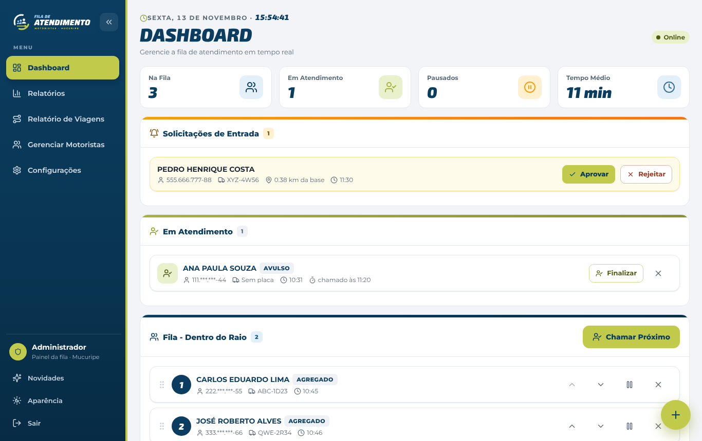
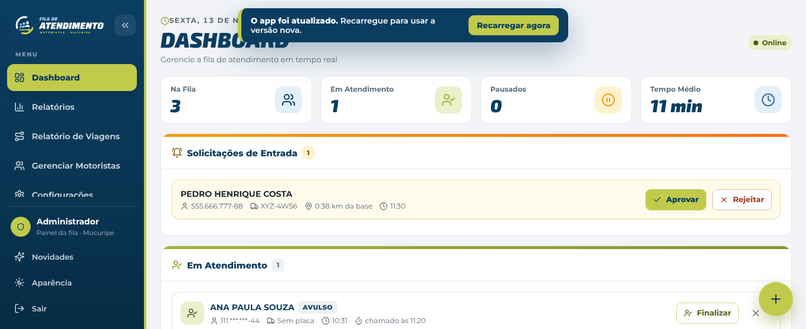
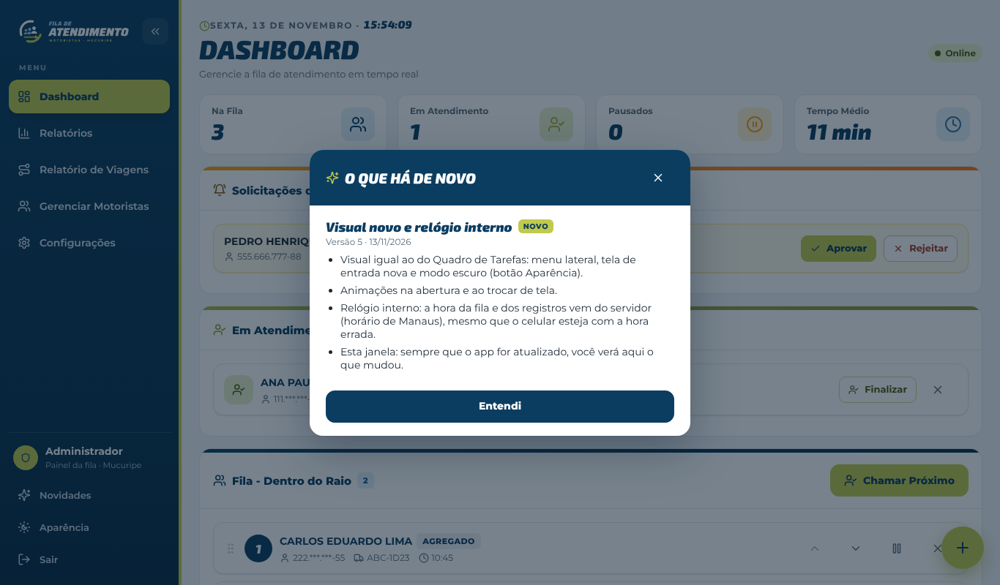

# Fila de Atendimento · Mucuripe Logística

Fila virtual de atendimento dos motoristas da **Mucuripe Logística** (Manaus/AM).
O motorista entra na fila pelo celular, acompanha a posição em tempo real e é avisado quando é chamado.
O administrador controla a fila, aprova as entradas e acompanha os relatórios.

Feito em **Google Apps Script**. Os dados ficam numa **planilha do Google**, então não há servidor nem mensalidade.

> **Abrir o app:** `https://SEU-USUARIO.github.io/fila-de-atendimento/` (GitHub Pages; veja [como ativar](docs/COMO_USAR_O_GITHUB.md#endereço-do-app-pelo-github-github-pages))
>
> Versão atual: **7** — veja o [CHANGELOG](CHANGELOG.md).

| Login | Painel do administrador | Motorista |
|---|---|---|
|  |  |  |

---

## O que o app faz

**Motorista**
- Entra com CPF e senha.
- Pede para entrar na fila. O GPS confere se ele está dentro do raio da base.
- Vê a própria posição e a fila de espera atualizando sozinhas, sem recarregar a página.
- Recebe aviso na tela (com som e vibração) quando é chamado.
- Tem perfil com foto, tema claro, escuro ou automático e a janela "Novidades do app".

**Administrador**
- **Dashboard:** solicitações de entrada, motoristas em atendimento e fila dentro e fora do raio. Dá para arrastar, subir, descer, pausar e remover motoristas, chamar o próximo (vários seguidos, sem precisar finalizar) ou **chamar vários de uma vez** (marcando quem, os primeiros N ou todos), sempre na ordem da fila.
- **Relatórios:** lista de presença, movimentos da fila, histórico de logs e histórico de ações.
- **Relatório de Viagens.**
- **Gerenciar Motoristas:** cadastrar, editar, bloquear e excluir.
- **Configurações:** localização da base, avisos e regras, troca da chave de acesso e arquivo morto.

**Sistema**
- **Relógio interno:** toda hora gravada vem do servidor, no horário de Manaus (UTC‑4). A hora fica certa mesmo que o celular esteja com a hora ou o fuso errados.
- **Arquivo morto:** a planilha principal guarda só os últimos 2 meses. O restante vai sozinho para a planilha "Fila Virtual - Arquivo Morto", todo dia às 3h.
- **Aviso de atualização:** quando sai uma versão nova, quem está com o app aberto vê o aviso "O app foi atualizado — Recarregar agora". Depois de recarregar, cada pessoa vê uma vez a janela **"O que há de novo"**.
- **Segurança:** as senhas são guardadas com hash e "sal", o login usa token assinado e há bloqueio depois de várias tentativas erradas.
- **Visual:** segue a identidade da Mucuripe (mesmo padrão do Quadro de Tarefas), com animações e modo escuro.

| Aviso de versão nova | Janela "O que há de novo" |
|---|---|
|  |  |

---

## Arquivos

```
index.html           → página do GitHub Pages: abre o app do Google por dentro (cole o link /exec nela)
manifest.webmanifest → permite instalar o app na tela inicial do celular
icone-192.png, icone-512.png → ícones do app
src/
  Codigo.gs          → servidor (Apps Script): login, fila, relatórios, relógio, arquivo morto, versões
  Index.html         → estrutura da página e todo o visual (CSS)
  JavaScript.html    → funcionamento das telas no navegador
  appsscript.json    → configurações do projeto (fuso de Manaus, serviço do Drive, web app)
docs/
  COMO_INSTALAR.md   → instalar do zero
  COMO_ATUALIZAR.md  → publicar uma versão nova (e avisar os usuários)
  COMO_USAR_O_GITHUB.md → guardar as mudanças aqui no GitHub
  imagens/           → capturas de tela (com dados fictícios)
```

## Guias rápidos

- **Primeira instalação:** [docs/COMO_INSTALAR.md](docs/COMO_INSTALAR.md)
- **Publicar uma atualização:** [docs/COMO_ATUALIZAR.md](docs/COMO_ATUALIZAR.md)
- **Usar este repositório:** [docs/COMO_USAR_O_GITHUB.md](docs/COMO_USAR_O_GITHUB.md)

## Cuidados

- O código não guarda senha nem dados: tudo fica na planilha do Google. Por isso o repositório pode ser público, que é o exigido para o GitHub Pages gratuito.
- **Nunca** envie para cá a planilha, as exportações (CSV/Excel) nem prints com CPF de motoristas. O `.gitignore` já bloqueia esses arquivos.
- A chave de administrador que está no código (`CHAVE_ADMIN_PADRAO`) só vale na **primeira instalação**. Troque-a logo em *Configurações › Alterar chave*. Em instalações que já existem ela não tem efeito.

---

Mucuripe Logística e Transportes de Cargas · Manaus/AM · uso interno
